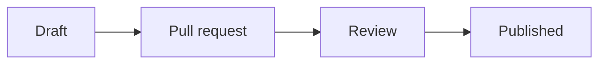

Guides are written in Markdown. This page shows the extra features the site supports. See [CONTRIBUTING.md](https://github.com/lstellway/notes/blob/main/CONTRIBUTING.md) for the full contributor guide.

## Asides

```md
:::note
Something worth pointing out.
:::

:::caution[Watch out]
Something that could go wrong.
:::
```

:::note
Something worth pointing out.
:::

:::caution[Watch out]
Something that could go wrong.
:::

The types are `note`, `tip`, `caution`, and `danger`.

## Math

Math uses [LaTeX](https://katex.org/docs/supported) syntax between double dollar signs. A single `$` is plain text, so amounts like $100 need no escaping.

- Inline, inside a sentence: `$$a^2 + b^2 = c^2$$` shows as $$a^2 + b^2 = c^2$$.
- As a block, with `$$` on their own lines:

```md
$$
A = P \left(1 + \frac{r}{n}\right)^{nt}
$$
```

$$
A = P \left(1 + \frac{r}{n}\right)^{nt}
$$

## Diagrams

Diagrams use [Mermaid](https://mermaid.js.org/intro/) syntax in a `mermaid` code block.

````md

````


## HTML

Raw HTML is removed from `.md` files when the site is built. Use Markdown syntax instead.
