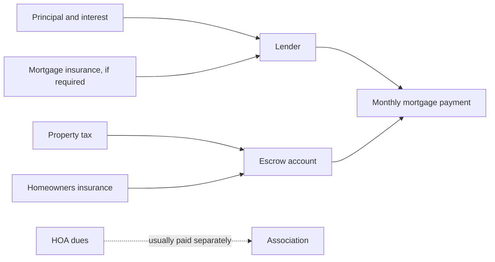

A mortgage payment has two layers. The core is the **principal and interest** payment, which repays the loan. On top of that, most homeowners also pay **property taxes, homeowners insurance**, and sometimes **mortgage insurance** or **HOA dues** each month. This guide explains both layers for a standard **fixed-rate** mortgage.

This guide describes how mortgages usually work in the **United States**. Loans in other countries can differ, for example in how often interest compounds.

## Principal and interest

- **Principal** is the amount you borrow: the home price minus your down payment.
- **Interest** is what the lender charges for lending you that money.

On a fixed-rate loan, the combined principal and interest payment stays the same every month for the whole term. What changes is the split: each month you pay interest on the balance you still owe, and the rest of the payment reduces that balance ([CFPB](https://www.consumerfinance.gov/ask-cfpb/how-does-paying-down-a-mortgage-work-en-1943/)). Paying a loan down on a fixed schedule like this is called **amortization**.

### The payment formula

The monthly principal and interest payment is

$$
M = P \cdot \frac{r(1 + r)^n}{(1 + r)^n - 1}
$$

where:

- $$M$$ is the monthly payment.
- $$P$$ is the principal (the loan amount).
- $$r$$ is the **monthly** interest rate: the yearly rate divided by 12. A 6% yearly rate is $$r = 0.06 / 12 = 0.005$$.
- $$n$$ is the number of monthly payments: 360 for a 30-year loan, 180 for a 15-year loan.

This is the payment that brings the balance to exactly zero after $$n$$ payments. If the rate were 0%, the formula wouldn't work (it divides by zero), and the payment would simply be $$P / n$$.

Each month, the interest part of the payment is the balance times $$r$$, and the principal part is whatever is left:

$$
\text{interest}_k = B_{k-1} \cdot r \qquad \text{principal}_k = M - \text{interest}_k \qquad B_k = B_{k-1} - \text{principal}_k
$$

where $$B_k$$ is the balance after payment $$k$$, and $$B_0 = P$$.

Lenders round each payment to the cent, so a real loan's figures can differ from the formula by a few cents, and the last payment is often slightly different from the others.

## A worked example

These numbers are made up to show the math. The rate is **not** a quote or a current market rate.

- Home price: $400,000
- Down payment: $80,000 (20%)
- Loan amount: $$P = \$320{,}000$$
- Yearly rate: 6.5%, so $$r = 0.065 / 12 \approx 0.0054167$$
- Term: 30 years, so $$n = 360$$

First, $$(1 + r)^{360} \approx 6.99180$$. Then

$$
M = 320{,}000 \cdot \frac{0.0054167 \times 6.99180}{6.99180 - 1} \approx \$2{,}022.62
$$

How the first payments and later payments split:

| Payment | Interest | Principal | Balance after |
|---|---|---|---|
| 1 | $1,733.33 | $289.28 | $319,710.72 |
| 2 | $1,731.77 | $290.85 | $319,419.86 |
| 60 (end of year 5) | $1,624.75 | $397.87 | $299,555.13 |
| 180 (end of year 15) | $1,261.81 | $760.80 | $232,189.25 |
| 300 (end of year 25) | $567.82 | $1,454.80 | $103,373.32 |
| 360 (last) | $10.90 | $2,011.72 | $0.00 |

In the first payment, $1,733.33 is interest: $320,000 × 0.065 ÷ 12. Early payments are mostly interest because the balance is at its highest. After five years, this borrower has paid about $121,357 in total but reduced the balance by only about $20,445. Principal doesn't make up the larger share of the payment until payment 233, more than 19 years in.

Over all 360 payments, the borrower pays $$360 \times \$2{,}022.62 \approx \$728{,}142$$, of which about **$408,142 is interest**.

You can check these numbers, or try your own, with the [mortgage calculator](/finance/tools/mortgage-calculator/).

## What else is in the monthly payment

Lenders and the CFPB often describe the full payment as **PITI**: principal, interest, taxes, and insurance ([CFPB](https://www.consumerfinance.gov/ask-cfpb/what-is-piti-en-152/)).

- **Property taxes** are set by local governments, usually based on the home's assessed value.
- **Homeowners insurance** covers damage to the home. Lenders require it.
- **Mortgage insurance** may be added. On a conventional loan, private mortgage insurance (PMI) is typically required when the down payment is less than 20% of the price. It protects the lender, not you, if you stop paying ([CFPB](https://www.consumerfinance.gov/ask-cfpb/what-is-private-mortgage-insurance-en-122/)). You can usually ask to cancel PMI once the balance is scheduled to reach 80% of the home's original value, and it must end automatically at 78% if you're current on payments ([CFPB](https://www.consumerfinance.gov/ask-cfpb/when-can-i-remove-private-mortgage-insurance-pmi-from-my-loan-en-202/)). Government-backed loans, such as FHA loans, have their own mortgage insurance rules.
- **HOA dues**, if the home is in a homeowners association, condo, or co-op. These are usually paid to the association separately, not to the lender.

Taxes and insurance are often collected with the mortgage payment and held in an **escrow account** (also called an impound account). The servicer then pays those bills when they're due. Because taxes and insurance premiums can change each year, the escrow part of the payment can change even though principal and interest stay fixed ([CFPB](https://www.consumerfinance.gov/ask-cfpb/what-is-an-escrow-or-impound-account-en-140/)).

Continuing the example with **assumed** costs of $4,800 a year in property tax ($400 a month) and $1,800 a year in insurance ($150 a month), and no PMI because the down payment is 20%:

$$
\$2{,}022.62 + \$400 + \$150 = \$2{,}572.62 \text{ per month}
$$

Tax and insurance costs vary widely by location and home, so use real quotes and tax records for your own estimate. The CFPB notes that many buyers focus on principal and interest and are surprised by the total. Page 1 of a Loan Estimate shows the estimated total monthly payment under "Projected Payments" ([CFPB](https://www.consumerfinance.gov/ask-cfpb/on-a-mortgage-whats-the-difference-between-my-principal-and-interest-payment-and-my-total-monthly-payment-en-1941/)).

## How the rate and term change the total

Using the same $320,000 loan, with only the rate or term changed. These rates are examples, not quotes.

| Rate | Term | Monthly principal and interest | Total interest |
|---|---|---|---|
| 5.5% | 30 years | $1,816.92 | $334,092.93 |
| 6.5% | 30 years | $2,022.62 | $408,142.36 |
| 7.5% | 30 years | $2,237.49 | $485,495.11 |
| 6.5% | 15 years | $2,787.54 | $181,757.84 |

- **A higher rate** raises both the monthly payment and the total interest. In this example, each percentage point adds roughly $210 a month and about $75,000 in interest over 30 years.
- **A shorter term** raises the monthly payment but cuts total interest sharply, because the balance shrinks faster and there are fewer months of interest. The 15-year row uses the same rate as the 30-year loan to show the effect of the term alone. In practice, 15-year loans are often offered at lower rates than 30-year loans, which would lower their total interest further.

## Paying extra toward principal

Any extra amount paid toward principal reduces the balance right away, so every later month charges less interest. The regular payment doesn't change, but the loan ends sooner.

In the example, paying an extra $200 every month toward principal pays the loan off in 281 payments (23 years and 5 months) instead of 360, and cuts total interest from about $408,142 to about $302,714, saving about $105,429.

Before paying extra, check that the payment will be applied to principal, and whether your loan has a **prepayment penalty**. These are usually tied to paying off the whole loan early, such as when refinancing or selling, rather than to small extra payments ([CFPB](https://www.consumerfinance.gov/ask-cfpb/what-is-a-prepayment-penalty-en-1957/)).

## Sources

- Consumer Financial Protection Bureau (CFPB): [How does paying down a mortgage work?](https://www.consumerfinance.gov/ask-cfpb/how-does-paying-down-a-mortgage-work-en-1943/)
- CFPB: [What is PITI?](https://www.consumerfinance.gov/ask-cfpb/what-is-piti-en-152/)
- CFPB: [On a mortgage, what's the difference between my principal and interest payment and my total monthly payment?](https://www.consumerfinance.gov/ask-cfpb/on-a-mortgage-whats-the-difference-between-my-principal-and-interest-payment-and-my-total-monthly-payment-en-1941/)
- CFPB: [What is private mortgage insurance?](https://www.consumerfinance.gov/ask-cfpb/what-is-private-mortgage-insurance-en-122/)
- CFPB: [When can I remove private mortgage insurance (PMI) from my loan?](https://www.consumerfinance.gov/ask-cfpb/when-can-i-remove-private-mortgage-insurance-pmi-from-my-loan-en-202/)
- CFPB: [What is an escrow or impound account?](https://www.consumerfinance.gov/ask-cfpb/what-is-an-escrow-or-impound-account-en-140/)
- CFPB: [What is a prepayment penalty?](https://www.consumerfinance.gov/ask-cfpb/what-is-a-prepayment-penalty-en-1957/)

The example figures were calculated with the formula above at full precision and rounded to the cent.
